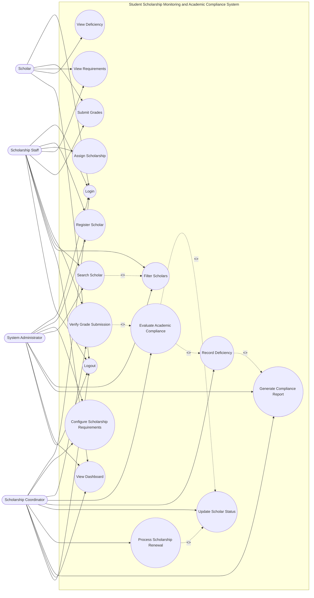

# Use Case Diagram

You can paste the following Mermaid diagram into a Mermaid-compatible Markdown viewer.

The laboratory requires at least 15 use cases, actors, a system boundary, three `<<include>>` relationships, and two `<<extend>>` relationships.
